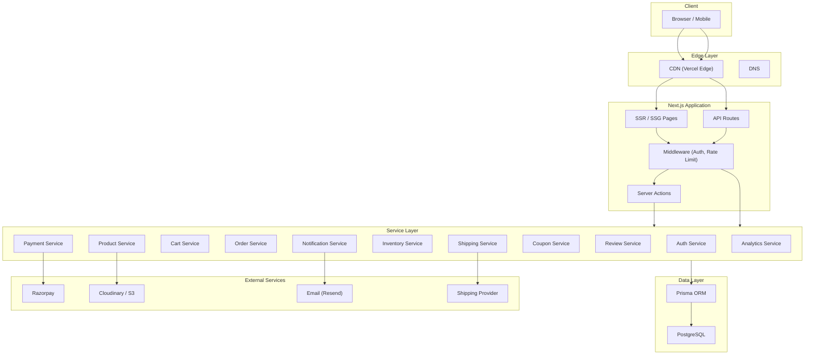
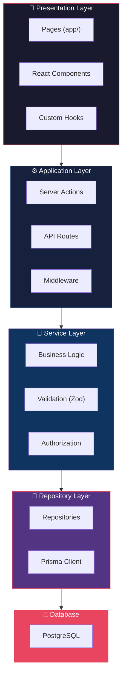
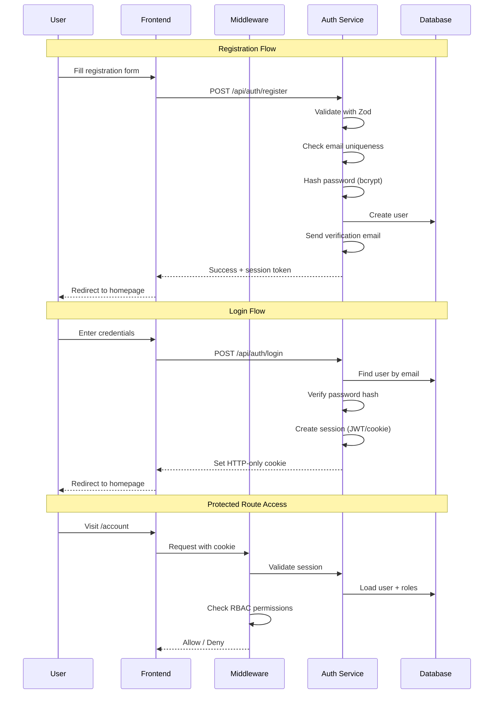
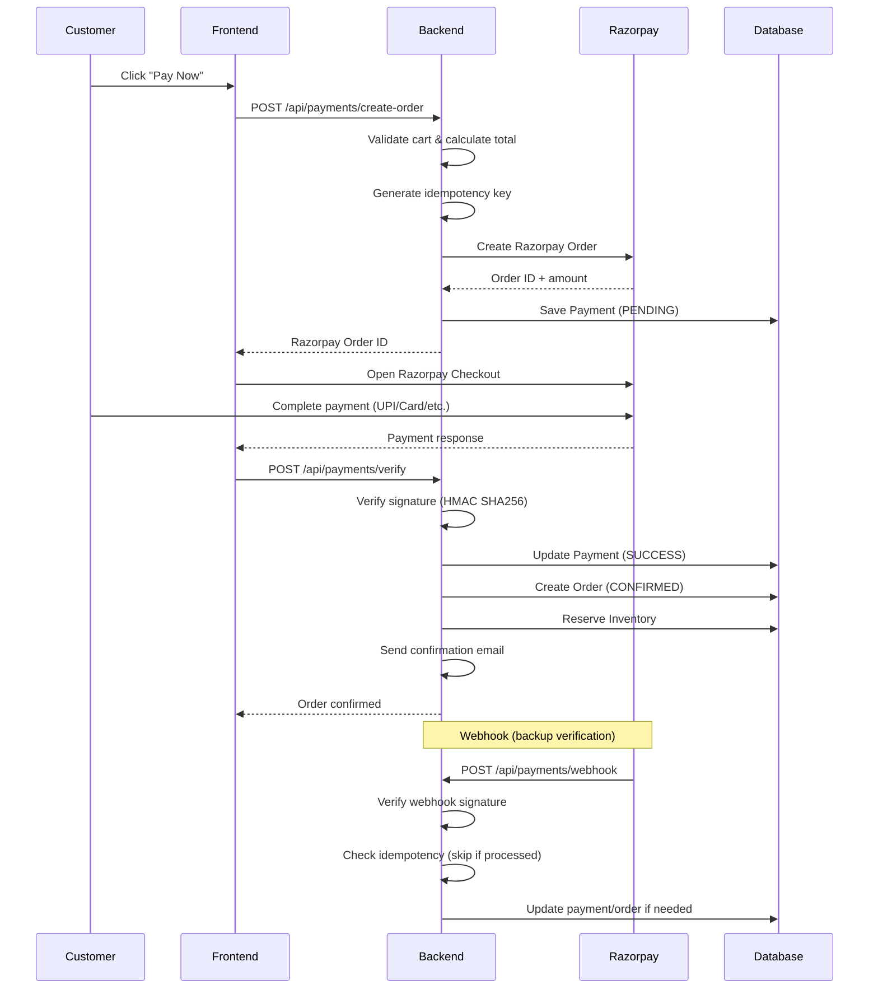
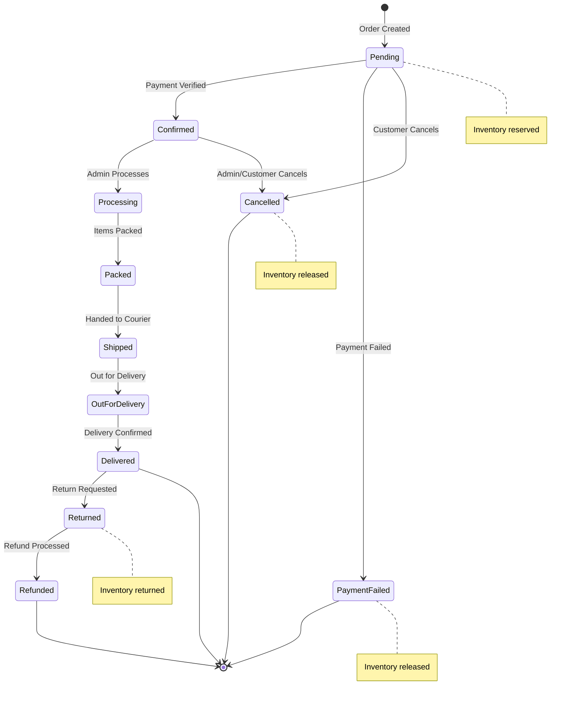
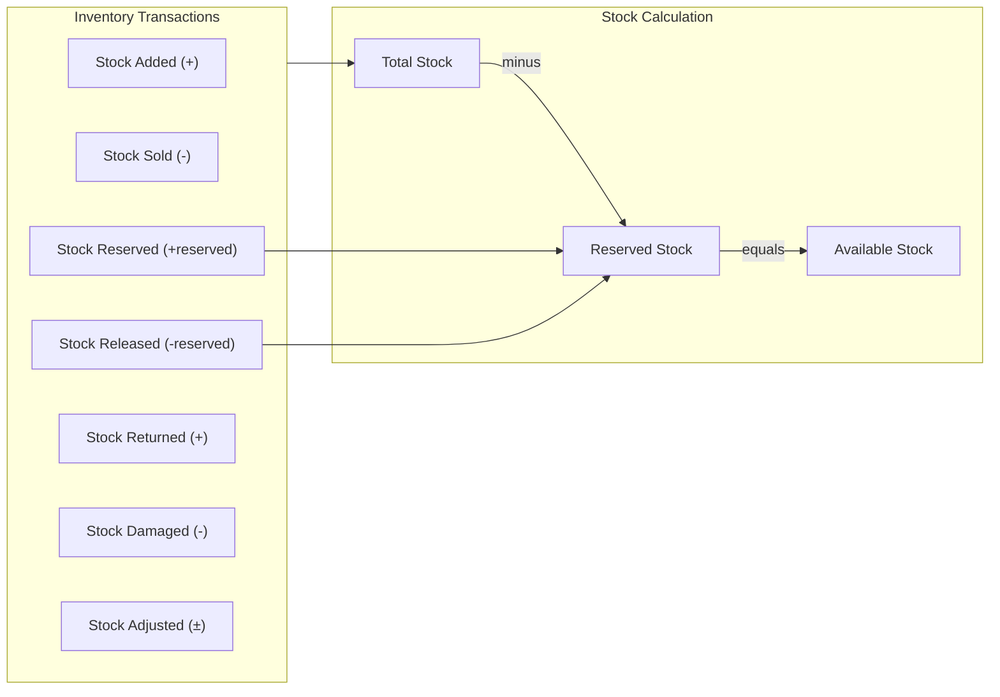
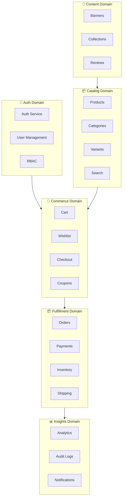
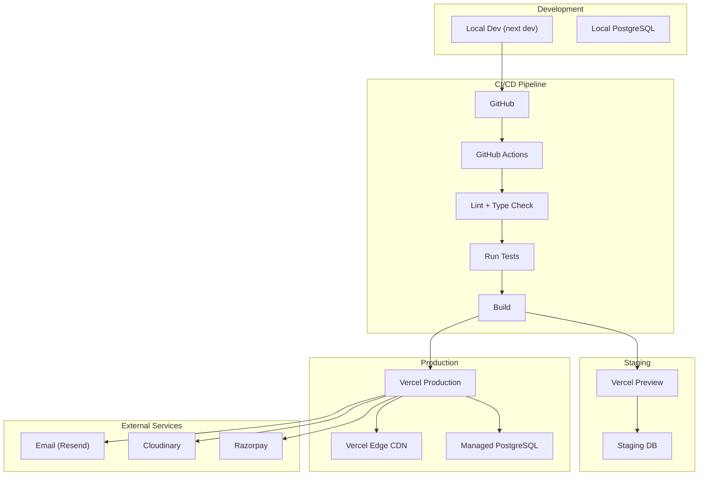

# SAMVERA — System Architecture Document

> **Version:** 1.0  
> **Date:** September 2026  
> **Status:** Draft

---

## 1. System Overview

SAMVERA follows a **modular monolith** architecture built on Next.js, with clear domain boundaries that can be extracted into services if scale demands it.



---

## 2. Technology Stack

| Layer | Technology | Version | Purpose |
|-------|-----------|---------|---------|
| **Framework** | Next.js | 14+ (App Router) | Full-stack React framework |
| **Language** | TypeScript | 5.x | Type-safe development |
| **UI Library** | React | 18+ | Component-based UI |
| **Styling** | Tailwind CSS | 3.x | Utility-first CSS |
| **Animation** | Framer Motion | 11+ | Smooth, performant animations |
| **State** | Zustand | 4.x | Lightweight client state |
| **Forms** | React Hook Form | 7.x | Performant form handling |
| **Validation** | Zod | 3.x | Schema validation (client + server) |
| **ORM** | Prisma | 5.x | Type-safe database access |
| **Database** | PostgreSQL | 16+ | Primary data store |
| **Auth** | NextAuth.js / Custom | — | Authentication & sessions |
| **Payments** | Razorpay | — | Payment processing |
| **Email** | Resend / Nodemailer | — | Transactional emails |
| **Images** | Cloudinary / S3 | — | Image storage & optimization |
| **Icons** | Lucide React | — | Consistent icon system |
| **Testing** | Jest + Playwright | — | Unit, integration, E2E |
| **Linting** | ESLint + Prettier | — | Code quality |

---

## 3. Application Architecture

The application follows a strict **layered architecture** to enforce separation of concerns:



### Layer Responsibilities

| Layer | Responsibility | Example |
|-------|---------------|---------|
| **Presentation** | UI rendering, user interaction, client state | Product card, cart drawer, forms |
| **Application** | Request handling, routing, middleware | API routes, server actions |
| **Service** | Business logic, validation, authorization | Price calculation, stock check, coupon validation |
| **Repository** | Data access, queries, mutations | Find product by slug, create order |
| **Database** | Data storage, constraints, indexes | PostgreSQL tables, relations |

### Rules
- Components **never** call Prisma directly
- API routes **never** contain business logic
- Services **never** import React components
- Repositories **never** handle HTTP requests
- All sensitive calculations happen in the **Service layer**

---

## 4. Project Structure

```
samvera/
├── app/                            # Next.js App Router
│   ├── (storefront)/               # Customer-facing (route group)
│   │   ├── page.tsx                # Homepage
│   │   ├── layout.tsx              # Storefront layout (navbar + footer)
│   │   ├── shop/
│   │   │   └── page.tsx            # All products
│   │   ├── category/
│   │   │   └── [slug]/
│   │   │       └── page.tsx        # Category page
│   │   ├── products/
│   │   │   └── [slug]/
│   │   │       └── page.tsx        # Product detail
│   │   ├── search/
│   │   │   └── page.tsx            # Search results
│   │   ├── cart/
│   │   │   └── page.tsx            # Cart page
│   │   ├── checkout/
│   │   │   └── page.tsx            # Checkout flow
│   │   ├── wishlist/
│   │   │   └── page.tsx            # Wishlist
│   │   └── account/
│   │       ├── page.tsx            # Account dashboard
│   │       ├── profile/
│   │       ├── orders/
│   │       │   ├── page.tsx
│   │       │   └── [id]/
│   │       ├── addresses/
│   │       └── reviews/
│   ├── (auth)/                     # Auth pages (route group)
│   │   ├── layout.tsx              # Auth layout (centered, minimal)
│   │   ├── login/
│   │   ├── register/
│   │   ├── forgot-password/
│   │   ├── reset-password/
│   │   └── verify-email/
│   ├── admin/                      # Admin dashboard
│   │   ├── layout.tsx              # Admin layout (sidebar)
│   │   ├── page.tsx                # Admin dashboard
│   │   ├── products/
│   │   ├── orders/
│   │   ├── customers/
│   │   ├── inventory/
│   │   ├── coupons/
│   │   ├── reviews/
│   │   ├── content/
│   │   ├── analytics/
│   │   └── settings/
│   ├── api/                        # API routes
│   │   ├── auth/
│   │   ├── products/
│   │   ├── categories/
│   │   ├── search/
│   │   ├── cart/
│   │   ├── wishlist/
│   │   ├── checkout/
│   │   ├── orders/
│   │   ├── payments/
│   │   ├── reviews/
│   │   ├── admin/
│   │   ├── notifications/
│   │   └── shipping/
│   ├── layout.tsx                  # Root layout
│   ├── loading.tsx                 # Global loading
│   ├── error.tsx                   # Global error
│   └── not-found.tsx               # 404 page
│
├── components/
│   ├── ui/                         # Design system primitives
│   │   ├── button.tsx
│   │   ├── input.tsx
│   │   ├── select.tsx
│   │   ├── modal.tsx
│   │   ├── drawer.tsx
│   │   ├── toast.tsx
│   │   ├── dropdown.tsx
│   │   ├── tabs.tsx
│   │   ├── accordion.tsx
│   │   ├── badge.tsx
│   │   ├── breadcrumb.tsx
│   │   ├── pagination.tsx
│   │   ├── skeleton.tsx
│   │   ├── spinner.tsx
│   │   ├── checkbox.tsx
│   │   ├── radio.tsx
│   │   └── index.ts
│   ├── layout/                     # Layout components
│   │   ├── navbar.tsx
│   │   ├── mobile-nav.tsx
│   │   ├── footer.tsx
│   │   ├── sidebar.tsx
│   │   └── admin-sidebar.tsx
│   ├── product/                    # Product components
│   │   ├── product-card.tsx
│   │   ├── product-grid.tsx
│   │   ├── product-gallery.tsx
│   │   ├── product-info.tsx
│   │   ├── variant-selector.tsx
│   │   ├── size-guide.tsx
│   │   ├── price-display.tsx
│   │   └── rating-display.tsx
│   ├── cart/
│   │   ├── cart-item.tsx
│   │   ├── cart-summary.tsx
│   │   └── cart-drawer.tsx
│   ├── checkout/
│   │   ├── address-form.tsx
│   │   ├── shipping-method.tsx
│   │   ├── order-summary.tsx
│   │   └── payment-form.tsx
│   ├── account/
│   ├── admin/
│   ├── home/                       # Homepage sections
│   │   ├── hero-section.tsx
│   │   ├── featured-categories.tsx
│   │   ├── product-section.tsx
│   │   ├── promo-banner.tsx
│   │   ├── testimonials.tsx
│   │   └── newsletter.tsx
│   └── shared/                     # Shared components
│       ├── search-bar.tsx
│       ├── filters.tsx
│       ├── sort-dropdown.tsx
│       └── empty-state.tsx
│
├── lib/                            # Core libraries
│   ├── auth/
│   │   ├── session.ts
│   │   ├── password.ts
│   │   ├── rbac.ts
│   │   └── middleware.ts
│   ├── db/
│   │   └── prisma.ts               # Prisma client singleton
│   ├── payments/
│   │   ├── razorpay.ts
│   │   └── webhook.ts
│   ├── shipping/
│   │   ├── provider.ts             # Abstract shipping interface
│   │   └── shiprocket.ts
│   ├── storage/
│   │   └── cloudinary.ts
│   ├── validation/
│   │   ├── auth.schema.ts
│   │   ├── product.schema.ts
│   │   ├── cart.schema.ts
│   │   ├── order.schema.ts
│   │   └── common.schema.ts
│   ├── notifications/
│   │   ├── email.ts
│   │   └── templates/
│   ├── analytics/
│   │   └── tracker.ts
│   └── utils/
│       ├── format.ts
│       ├── slug.ts
│       ├── sku.ts
│       ├── errors.ts
│       └── constants.ts
│
├── services/                       # Business logic layer
│   ├── auth.service.ts
│   ├── user.service.ts
│   ├── product.service.ts
│   ├── category.service.ts
│   ├── cart.service.ts
│   ├── wishlist.service.ts
│   ├── order.service.ts
│   ├── payment.service.ts
│   ├── inventory.service.ts
│   ├── coupon.service.ts
│   ├── review.service.ts
│   ├── shipping.service.ts
│   ├── notification.service.ts
│   ├── analytics.service.ts
│   └── audit.service.ts
│
├── repositories/                   # Data access layer
│   ├── user.repository.ts
│   ├── product.repository.ts
│   ├── order.repository.ts
│   ├── inventory.repository.ts
│   └── ...
│
├── types/                          # TypeScript type definitions
│   ├── product.ts
│   ├── order.ts
│   ├── user.ts
│   ├── cart.ts
│   ├── payment.ts
│   ├── api.ts
│   └── index.ts
│
├── hooks/                          # Custom React hooks
│   ├── use-cart.ts
│   ├── use-wishlist.ts
│   ├── use-auth.ts
│   ├── use-search.ts
│   ├── use-filters.ts
│   └── use-debounce.ts
│
├── stores/                         # Zustand stores
│   ├── cart-store.ts
│   ├── wishlist-store.ts
│   ├── auth-store.ts
│   └── ui-store.ts
│
├── config/                         # Configuration
│   ├── site.ts
│   ├── navigation.ts
│   └── constants.ts
│
├── prisma/
│   ├── schema.prisma
│   ├── migrations/
│   └── seed.ts
│
├── tests/
│   ├── unit/
│   ├── integration/
│   └── e2e/
│
├── scripts/
│   └── seed.ts
│
├── public/
│   ├── images/
│   ├── fonts/
│   └── icons/
│
├── docs/
│   ├── PRD.md
│   ├── ARCHITECTURE.md
│   ├── DATABASE.md
│   └── API.md
│
├── .env.example
├── .env.local
├── .gitignore
├── next.config.ts
├── tailwind.config.ts
├── tsconfig.json
├── package.json
└── README.md
```

---

## 5. Authentication Architecture



### Session Strategy
- **HTTP-only, Secure, SameSite cookies**
- JWT token with short expiry + refresh token rotation
- Session stored server-side for revocation capability

### RBAC Implementation
```typescript
// Permission check flow
User → UserRole → Role → RolePermission → Permission

// Example permissions
"product:create", "product:update", "product:delete"
"order:view", "order:update", "order:cancel"
"inventory:view", "inventory:adjust"
```

---

## 6. Payment Architecture



### Payment Security Rules
1. **Never trust frontend-reported payment success**
2. **Always verify via Razorpay API or webhook**
3. **Use idempotency keys** to prevent double processing
4. **Store all transaction data** for audit
5. **Handle webhook duplicates** gracefully

---

## 7. Order State Machine



### State Transition Rules
| From | To | Trigger | Side Effects |
|------|----|---------|--------------|
| — | Pending | Order created | Reserve inventory |
| Pending | Confirmed | Payment verified | Send confirmation email |
| Pending | PaymentFailed | Payment fails | Release inventory |
| Pending | Cancelled | Cancellation | Release inventory, refund if paid |
| Confirmed | Processing | Admin action | — |
| Processing | Packed | Admin action | — |
| Packed | Shipped | Shipping created | Send shipping email, tracking |
| Shipped | OutForDelivery | Carrier update | Send notification |
| OutForDelivery | Delivered | Delivery confirmed | Send delivery email |
| Delivered | Returned | Return request | Process return |
| Returned | Refunded | Refund processed | Return inventory, process refund |

---

## 8. Inventory Architecture



### Concurrency Strategy
```
1. Customer adds to cart → No reservation yet
2. Checkout initiated → Validate stock availability
3. Payment created → Reserve stock (with row-level lock)
4. Payment confirmed → Mark as sold
5. Payment failed → Release reservation
6. Timeout → Release reservation (background job)
```

### Critical: Preventing Overselling
- Use `SELECT ... FOR UPDATE` for concurrent stock checks
- Database transactions for reserve → sell operations
- Periodic reconciliation job

---

## 9. Domain Boundaries



Each domain:
- Has its own **service** (business logic)
- Has its own **repository** (data access)
- Has its own **validation schemas** (Zod)
- Has its own **types** (TypeScript)
- Communicates with other domains through **service interfaces**

---

## 10. Security Architecture

### Defense Layers

| Layer | Protection | Implementation |
|-------|-----------|----------------|
| **Edge** | DDoS, bot protection | Vercel/Cloudflare |
| **Transport** | HTTPS, HSTS | TLS certificates |
| **Middleware** | Rate limiting, CSRF | Next.js middleware |
| **Authentication** | Session validation | JWT + HTTP-only cookies |
| **Authorization** | RBAC permission checks | Service-level checks |
| **Validation** | Input sanitization | Zod schemas on every endpoint |
| **Data** | SQL injection prevention | Prisma (parameterized queries) |
| **Output** | XSS prevention | React auto-escaping + CSP |
| **Secrets** | Credential protection | Environment variables, never exposed |
| **Audit** | Action tracking | AuditLog table |

### Security Headers
```
Content-Security-Policy: default-src 'self'
X-Content-Type-Options: nosniff
X-Frame-Options: DENY
X-XSS-Protection: 1; mode=block
Strict-Transport-Security: max-age=31536000; includeSubDomains
Referrer-Policy: strict-origin-when-cross-origin
```

---

## 11. Deployment Architecture



### Environment Strategy
| Environment | Purpose | Database | Payments |
|-------------|---------|----------|----------|
| **Development** | Local dev | Local PostgreSQL | Razorpay Test Mode |
| **Staging** | Pre-production testing | Staging DB | Razorpay Test Mode |
| **Production** | Live | Managed PostgreSQL | Razorpay Live Mode |

---

## 12. Caching Strategy

| Data | Cache | TTL | Invalidation |
|------|-------|-----|--------------|
| Product listings | ISR (Next.js) | 60s | On-demand revalidation |
| Product details | ISR | 60s | On product update |
| Categories | Static | Build time | On rebuild |
| Cart | No cache | — | Real-time |
| User session | Server memory | 24h | On logout |
| Search results | Client + API | 30s | Time-based |
| Admin dashboard | No cache | — | Real-time |
| Static assets | CDN | 1 year | Content hash |

---

## 13. Error Handling Strategy

### Standard API Error Response
```typescript
interface ApiResponse<T> {
  success: boolean;
  data?: T;
  error?: {
    code: string;        // Machine-readable: "PRODUCT_NOT_FOUND"
    message: string;     // Human-readable: "Product not found"
    details?: Record<string, string[]>; // Field-level errors
  };
  meta?: {
    page: number;
    limit: number;
    total: number;
    totalPages: number;
  };
}
```

### Error Hierarchy
```typescript
AppError (base)
├── ValidationError (400)
├── AuthenticationError (401)
├── AuthorizationError (403)
├── NotFoundError (404)
├── ConflictError (409)
├── RateLimitError (429)
├── PaymentError (402)
└── InternalError (500)
```

### Rules
- Never expose stack traces in production
- Log full error details server-side
- Return user-friendly messages client-side
- Use error boundaries in React for graceful UI fallback

---

## 14. Observability

### Logging Strategy
```
[timestamp] [level] [requestId] [service] [message] [metadata]
```

### Key Metrics
| Category | Metrics |
|----------|---------|
| **Performance** | Response time (p50, p95, p99), throughput |
| **Errors** | Error rate, error types, 5xx count |
| **Business** | Orders/hour, revenue, conversion rate |
| **Database** | Query time, connection pool, slow queries |
| **Payments** | Success rate, failure rate, webhook latency |
| **Infrastructure** | CPU, memory, disk, network |

### Recommended Tools
- **Error Tracking:** Sentry
- **Analytics:** PostHog / Mixpanel
- **Monitoring:** Vercel Analytics + custom dashboards
- **Logging:** Structured JSON logs → log aggregation service

---

*This architecture document will evolve as the system grows. All major architectural decisions should be documented here.*
