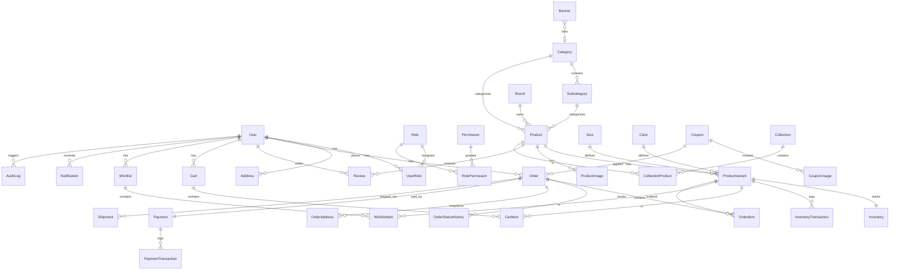

# SAMVERA — Database Design Document

> **Version:** 1.0  
> **Date:** September 2026  
> **Status:** Draft

---

## 1. Overview

- **Database:** PostgreSQL 16+
- **ORM:** Prisma 5.x
- **Design:** Relational with full referential integrity
- **Inventory:** SKU/variant-level tracking with transaction audit trail
- **Orders:** Address snapshots, status history, payment transactions
- **Auth:** RBAC with Role → Permission mapping

---

## 2. Entity Relationship Diagram



---

## 3. Entity Definitions

### 3.1 User

| Column | Type | Constraints | Description |
|--------|------|-------------|-------------|
| id | String (cuid) | PK | Unique identifier |
| email | String | Unique, Not Null | User email |
| password | String | Not Null | Bcrypt hashed password |
| firstName | String | Not Null | First name |
| lastName | String | Not Null | Last name |
| phone | String? | — | Phone number |
| avatar | String? | — | Avatar URL |
| emailVerified | Boolean | Default: false | Email verification status |
| emailVerifyToken | String? | — | Email verification token |
| passwordResetToken | String? | — | Password reset token |
| passwordResetExpiry | DateTime? | — | Token expiry |
| isActive | Boolean | Default: true | Account active status |
| lastLoginAt | DateTime? | — | Last login timestamp |
| createdAt | DateTime | Default: now() | Created timestamp |
| updatedAt | DateTime | @updatedAt | Updated timestamp |

### 3.2 Role

| Column | Type | Constraints | Description |
|--------|------|-------------|-------------|
| id | String (cuid) | PK | Unique identifier |
| name | String | Unique, Not Null | Role name (CUSTOMER, ADMIN) |
| description | String? | — | Role description |
| isDefault | Boolean | Default: false | Auto-assign on registration |
| createdAt | DateTime | Default: now() | Created timestamp |
| updatedAt | DateTime | @updatedAt | Updated timestamp |

### 3.3 Permission

| Column | Type | Constraints | Description |
|--------|------|-------------|-------------|
| id | String (cuid) | PK | Unique identifier |
| name | String | Unique, Not Null | Permission key (e.g., "product:create") |
| description | String? | — | Permission description |
| module | String | Not Null | Module name (product, order, etc.) |
| createdAt | DateTime | Default: now() | Created timestamp |

### 3.4 UserRole (Join)

| Column | Type | Constraints | Description |
|--------|------|-------------|-------------|
| userId | String | FK → User, PK | User reference |
| roleId | String | FK → Role, PK | Role reference |
| assignedAt | DateTime | Default: now() | Assignment timestamp |

### 3.5 RolePermission (Join)

| Column | Type | Constraints | Description |
|--------|------|-------------|-------------|
| roleId | String | FK → Role, PK | Role reference |
| permissionId | String | FK → Permission, PK | Permission reference |

### 3.6 Address

| Column | Type | Constraints | Description |
|--------|------|-------------|-------------|
| id | String (cuid) | PK | Unique identifier |
| userId | String | FK → User, Not Null | Owner |
| firstName | String | Not Null | Recipient first name |
| lastName | String | Not Null | Recipient last name |
| phone | String | Not Null | Contact phone |
| addressLine1 | String | Not Null | Street address |
| addressLine2 | String? | — | Apt, suite, etc. |
| city | String | Not Null | City |
| state | String | Not Null | State/Province |
| postalCode | String | Not Null | PIN/ZIP code |
| country | String | Default: "IN" | Country code |
| isDefault | Boolean | Default: false | Default address flag |
| createdAt | DateTime | Default: now() | Created timestamp |
| updatedAt | DateTime | @updatedAt | Updated timestamp |

### 3.7 Category

| Column | Type | Constraints | Description |
|--------|------|-------------|-------------|
| id | String (cuid) | PK | Unique identifier |
| name | String | Not Null | Category name |
| slug | String | Unique, Not Null | URL-friendly slug |
| description | String? | — | Category description |
| image | String? | — | Category image URL |
| displayOrder | Int | Default: 0 | Sort order |
| isActive | Boolean | Default: true | Visibility flag |
| metaTitle | String? | — | SEO title |
| metaDescription | String? | — | SEO description |
| createdAt | DateTime | Default: now() | Created timestamp |
| updatedAt | DateTime | @updatedAt | Updated timestamp |

### 3.8 Subcategory

| Column | Type | Constraints | Description |
|--------|------|-------------|-------------|
| id | String (cuid) | PK | Unique identifier |
| categoryId | String | FK → Category, Not Null | Parent category |
| name | String | Not Null | Subcategory name |
| slug | String | Unique, Not Null | URL-friendly slug |
| description | String? | — | Description |
| image | String? | — | Image URL |
| displayOrder | Int | Default: 0 | Sort order |
| isActive | Boolean | Default: true | Visibility flag |
| createdAt | DateTime | Default: now() | Created timestamp |
| updatedAt | DateTime | @updatedAt | Updated timestamp |

### 3.9 Brand

| Column | Type | Constraints | Description |
|--------|------|-------------|-------------|
| id | String (cuid) | PK | Unique identifier |
| name | String | Unique, Not Null | Brand name |
| slug | String | Unique, Not Null | URL-friendly slug |
| logo | String? | — | Logo URL |
| description | String? | — | Brand description |
| isActive | Boolean | Default: true | Visibility flag |
| createdAt | DateTime | Default: now() | Created timestamp |
| updatedAt | DateTime | @updatedAt | Updated timestamp |

### 3.10 Size

| Column | Type | Constraints | Description |
|--------|------|-------------|-------------|
| id | String (cuid) | PK | Unique identifier |
| name | String | Unique, Not Null | Size label (S, M, L, XL, XXL) |
| displayOrder | Int | Default: 0 | Sort order |
| createdAt | DateTime | Default: now() | Created timestamp |

### 3.11 Color

| Column | Type | Constraints | Description |
|--------|------|-------------|-------------|
| id | String (cuid) | PK | Unique identifier |
| name | String | Unique, Not Null | Color name (Black, White, Navy) |
| hexCode | String | Not Null | Hex color code (#000000) |
| displayOrder | Int | Default: 0 | Sort order |
| createdAt | DateTime | Default: now() | Created timestamp |

### 3.12 Product

| Column | Type | Constraints | Description |
|--------|------|-------------|-------------|
| id | String (cuid) | PK | Unique identifier |
| name | String | Not Null | Product name |
| slug | String | Unique, Not Null | URL slug |
| shortDescription | String? | — | Brief description (for cards) |
| description | String | Not Null | Full description (rich text) |
| specifications | Json? | — | Key-value specs |
| material | String? | — | Material info |
| fit | String? | — | Fit type (Regular, Slim, Oversized) |
| careInstructions | String? | — | Care instructions |
| basePrice | Decimal(10,2) | Not Null | Base price (INR) |
| compareAtPrice | Decimal(10,2)? | — | MRP / strikethrough price |
| categoryId | String | FK → Category, Not Null | Category |
| subcategoryId | String? | FK → Subcategory | Subcategory |
| brandId | String? | FK → Brand | Brand |
| status | ProductStatus | Default: DRAFT | Publication status |
| isFeatured | Boolean | Default: false | Featured on homepage |
| isNewArrival | Boolean | Default: false | New arrivals section |
| isBestSeller | Boolean | Default: false | Best sellers section |
| weight | Decimal(8,2)? | — | Product weight (grams) |
| metaTitle | String? | — | SEO title |
| metaDescription | String? | — | SEO description |
| metaKeywords | String[]? | — | SEO keywords |
| videoUrl | String? | — | Product video URL |
| createdAt | DateTime | Default: now() | Created timestamp |
| updatedAt | DateTime | @updatedAt | Updated timestamp |
| deletedAt | DateTime? | — | Soft delete timestamp |

### 3.13 ProductVariant

| Column | Type | Constraints | Description |
|--------|------|-------------|-------------|
| id | String (cuid) | PK | Unique identifier |
| productId | String | FK → Product, Not Null | Parent product |
| sizeId | String | FK → Size, Not Null | Size |
| colorId | String | FK → Color, Not Null | Color |
| sku | String | Unique, Not Null | SKU code (SAM-BLK-OVR-M) |
| price | Decimal(10,2) | Not Null | Variant-specific price |
| compareAtPrice | Decimal(10,2)? | — | MRP / strikethrough |
| weight | Decimal(8,2)? | — | Variant weight override |
| isActive | Boolean | Default: true | Availability flag |
| createdAt | DateTime | Default: now() | Created timestamp |
| updatedAt | DateTime | @updatedAt | Updated timestamp |

**Unique constraint:** `@@unique([productId, sizeId, colorId])`

### 3.14 ProductImage

| Column | Type | Constraints | Description |
|--------|------|-------------|-------------|
| id | String (cuid) | PK | Unique identifier |
| productId | String | FK → Product, Not Null | Product |
| url | String | Not Null | Image URL |
| altText | String? | — | Alt text for accessibility |
| displayOrder | Int | Default: 0 | Sort order |
| isPrimary | Boolean | Default: false | Primary image flag |
| colorId | String? | FK → Color | Color-specific image |
| createdAt | DateTime | Default: now() | Created timestamp |

### 3.15 Inventory

| Column | Type | Constraints | Description |
|--------|------|-------------|-------------|
| id | String (cuid) | PK | Unique identifier |
| variantId | String | FK → ProductVariant, Unique, Not Null | Variant reference |
| totalStock | Int | Not Null, Default: 0 | Total stock count |
| reservedStock | Int | Not Null, Default: 0 | Reserved (in checkout) |
| lowStockThreshold | Int | Default: 5 | Alert threshold |
| createdAt | DateTime | Default: now() | Created timestamp |
| updatedAt | DateTime | @updatedAt | Updated timestamp |

**Computed:** `availableStock = totalStock - reservedStock`  
**Constraint:** `reservedStock <= totalStock`

### 3.16 InventoryTransaction

| Column | Type | Constraints | Description |
|--------|------|-------------|-------------|
| id | String (cuid) | PK | Unique identifier |
| inventoryId | String | FK → Inventory, Not Null | Inventory reference |
| type | InventoryTransactionType | Not Null | Transaction type |
| quantity | Int | Not Null | Quantity changed (±) |
| previousStock | Int | Not Null | Stock before change |
| newStock | Int | Not Null | Stock after change |
| reference | String? | — | Reference (order ID, etc.) |
| notes | String? | — | Additional notes |
| performedBy | String? | FK → User | Who made the change |
| createdAt | DateTime | Default: now() | Created timestamp |

### 3.17 Cart

| Column | Type | Constraints | Description |
|--------|------|-------------|-------------|
| id | String (cuid) | PK | Unique identifier |
| userId | String | FK → User, Unique, Not Null | Cart owner |
| createdAt | DateTime | Default: now() | Created timestamp |
| updatedAt | DateTime | @updatedAt | Updated timestamp |

### 3.18 CartItem

| Column | Type | Constraints | Description |
|--------|------|-------------|-------------|
| id | String (cuid) | PK | Unique identifier |
| cartId | String | FK → Cart, Not Null | Cart reference |
| variantId | String | FK → ProductVariant, Not Null | Variant |
| quantity | Int | Not Null, Min: 1 | Quantity |
| createdAt | DateTime | Default: now() | Created timestamp |
| updatedAt | DateTime | @updatedAt | Updated timestamp |

**Unique constraint:** `@@unique([cartId, variantId])`

### 3.19 Wishlist

| Column | Type | Constraints | Description |
|--------|------|-------------|-------------|
| id | String (cuid) | PK | Unique identifier |
| userId | String | FK → User, Unique, Not Null | Wishlist owner |
| createdAt | DateTime | Default: now() | Created timestamp |
| updatedAt | DateTime | @updatedAt | Updated timestamp |

### 3.20 WishlistItem

| Column | Type | Constraints | Description |
|--------|------|-------------|-------------|
| id | String (cuid) | PK | Unique identifier |
| wishlistId | String | FK → Wishlist, Not Null | Wishlist reference |
| productId | String | FK → Product, Not Null | Product |
| variantId | String? | FK → ProductVariant | Preferred variant |
| createdAt | DateTime | Default: now() | Created timestamp |

**Unique constraint:** `@@unique([wishlistId, productId])`

### 3.21 Order

| Column | Type | Constraints | Description |
|--------|------|-------------|-------------|
| id | String (cuid) | PK | Unique identifier |
| orderNumber | String | Unique, Not Null | Human-readable order number (SAM-20260908-XXXX) |
| userId | String | FK → User, Not Null | Customer |
| status | OrderStatus | Default: PENDING | Current order status |
| subtotal | Decimal(10,2) | Not Null | Items total before discount |
| discount | Decimal(10,2) | Default: 0 | Discount amount |
| shippingCost | Decimal(10,2) | Default: 0 | Shipping charges |
| tax | Decimal(10,2) | Default: 0 | Tax amount |
| total | Decimal(10,2) | Not Null | Grand total |
| couponId | String? | FK → Coupon | Applied coupon |
| couponCode | String? | — | Snapshot of coupon code |
| notes | String? | — | Customer notes |
| cancelReason | String? | — | Cancellation reason |
| returnReason | String? | — | Return reason |
| createdAt | DateTime | Default: now() | Created timestamp |
| updatedAt | DateTime | @updatedAt | Updated timestamp |

### 3.22 OrderItem

| Column | Type | Constraints | Description |
|--------|------|-------------|-------------|
| id | String (cuid) | PK | Unique identifier |
| orderId | String | FK → Order, Not Null | Order reference |
| productId | String | FK → Product, Not Null | Product reference |
| variantId | String | FK → ProductVariant, Not Null | Variant reference |
| productName | String | Not Null | Snapshot: product name |
| variantName | String | Not Null | Snapshot: "M / Black" |
| sku | String | Not Null | Snapshot: SKU |
| price | Decimal(10,2) | Not Null | Snapshot: unit price |
| quantity | Int | Not Null | Quantity ordered |
| total | Decimal(10,2) | Not Null | price × quantity |
| imageUrl | String? | — | Snapshot: product image |
| createdAt | DateTime | Default: now() | Created timestamp |

### 3.23 OrderAddress (Snapshot)

| Column | Type | Constraints | Description |
|--------|------|-------------|-------------|
| id | String (cuid) | PK | Unique identifier |
| orderId | String | FK → Order, Not Null | Order reference |
| type | AddressType | Not Null | BILLING or SHIPPING |
| firstName | String | Not Null | Recipient first name |
| lastName | String | Not Null | Recipient last name |
| phone | String | Not Null | Contact phone |
| addressLine1 | String | Not Null | Street address |
| addressLine2 | String? | — | Apt/suite |
| city | String | Not Null | City |
| state | String | Not Null | State |
| postalCode | String | Not Null | PIN code |
| country | String | Default: "IN" | Country |
| createdAt | DateTime | Default: now() | Created timestamp |

> **Important:** This is a SNAPSHOT. Editing the customer's address after order placement does NOT affect existing orders.

### 3.24 OrderStatusHistory

| Column | Type | Constraints | Description |
|--------|------|-------------|-------------|
| id | String (cuid) | PK | Unique identifier |
| orderId | String | FK → Order, Not Null | Order reference |
| fromStatus | OrderStatus? | — | Previous status |
| toStatus | OrderStatus | Not Null | New status |
| notes | String? | — | Status change notes |
| changedBy | String? | FK → User | Who changed it |
| createdAt | DateTime | Default: now() | Timestamp |

### 3.25 Payment

| Column | Type | Constraints | Description |
|--------|------|-------------|-------------|
| id | String (cuid) | PK | Unique identifier |
| orderId | String | FK → Order, Unique, Not Null | Order reference |
| method | PaymentMethod | Not Null | Payment method used |
| status | PaymentStatus | Default: PENDING | Payment status |
| amount | Decimal(10,2) | Not Null | Payment amount |
| currency | String | Default: "INR" | Currency code |
| gatewayOrderId | String? | Unique | Razorpay order ID |
| gatewayPaymentId | String? | Unique | Razorpay payment ID |
| gatewaySignature | String? | — | Razorpay signature |
| idempotencyKey | String | Unique, Not Null | Idempotency key |
| gatewayResponse | Json? | — | Full gateway response |
| failureReason | String? | — | Failure reason |
| refundId | String? | — | Refund ID if refunded |
| refundAmount | Decimal(10,2)? | — | Refund amount |
| refundedAt | DateTime? | — | Refund timestamp |
| paidAt | DateTime? | — | Payment timestamp |
| createdAt | DateTime | Default: now() | Created timestamp |
| updatedAt | DateTime | @updatedAt | Updated timestamp |

### 3.26 PaymentTransaction (Audit Log)

| Column | Type | Constraints | Description |
|--------|------|-------------|-------------|
| id | String (cuid) | PK | Unique identifier |
| paymentId | String | FK → Payment, Not Null | Payment reference |
| type | String | Not Null | CREATED, AUTHORIZED, CAPTURED, FAILED, REFUNDED |
| amount | Decimal(10,2) | Not Null | Transaction amount |
| gatewayResponse | Json? | — | Raw gateway response |
| createdAt | DateTime | Default: now() | Timestamp |

### 3.27 Coupon

| Column | Type | Constraints | Description |
|--------|------|-------------|-------------|
| id | String (cuid) | PK | Unique identifier |
| code | String | Unique, Not Null | Coupon code (SAMVERA20) |
| type | CouponType | Not Null | PERCENTAGE or FLAT |
| value | Decimal(10,2) | Not Null | Discount value |
| minOrderAmount | Decimal(10,2)? | — | Minimum order amount |
| maxDiscount | Decimal(10,2)? | — | Max discount cap (for %) |
| startDate | DateTime | Not Null | Validity start |
| endDate | DateTime | Not Null | Validity end |
| usageLimit | Int? | — | Total usage limit |
| usedCount | Int | Default: 0 | Times used |
| perUserLimit | Int | Default: 1 | Per-user usage limit |
| isActive | Boolean | Default: true | Active flag |
| applicableCategories | String[]? | — | Category IDs (null = all) |
| applicableProducts | String[]? | — | Product IDs (null = all) |
| description | String? | — | Internal description |
| createdAt | DateTime | Default: now() | Created timestamp |
| updatedAt | DateTime | @updatedAt | Updated timestamp |

### 3.28 CouponUsage

| Column | Type | Constraints | Description |
|--------|------|-------------|-------------|
| id | String (cuid) | PK | Unique identifier |
| couponId | String | FK → Coupon, Not Null | Coupon reference |
| userId | String | FK → User, Not Null | User who used it |
| orderId | String | FK → Order, Not Null | Order it was applied to |
| discountAmount | Decimal(10,2) | Not Null | Actual discount given |
| createdAt | DateTime | Default: now() | Timestamp |

**Unique constraint:** `@@unique([couponId, userId, orderId])`

### 3.29 Review

| Column | Type | Constraints | Description |
|--------|------|-------------|-------------|
| id | String (cuid) | PK | Unique identifier |
| userId | String | FK → User, Not Null | Reviewer |
| productId | String | FK → Product, Not Null | Product reviewed |
| orderId | String? | FK → Order | Associated order |
| rating | Int | Not Null, Min: 1, Max: 5 | Star rating |
| title | String? | — | Review title |
| comment | String? | — | Review body |
| images | String[]? | — | Review image URLs |
| isVerified | Boolean | Default: false | Verified purchase |
| isApproved | Boolean | Default: false | Admin approved |
| isHidden | Boolean | Default: false | Hidden by admin |
| createdAt | DateTime | Default: now() | Created timestamp |
| updatedAt | DateTime | @updatedAt | Updated timestamp |

**Unique constraint:** `@@unique([userId, productId])` (one review per product per user)

### 3.30 Banner

| Column | Type | Constraints | Description |
|--------|------|-------------|-------------|
| id | String (cuid) | PK | Unique identifier |
| title | String | Not Null | Banner title |
| subtitle | String? | — | Banner subtitle |
| imageUrl | String | Not Null | Banner image |
| mobileImageUrl | String? | — | Mobile-specific image |
| linkUrl | String? | — | Click destination |
| position | BannerPosition | Not Null | HERO, PROMOTIONAL, CATEGORY |
| displayOrder | Int | Default: 0 | Sort order |
| isActive | Boolean | Default: true | Active flag |
| startDate | DateTime? | — | Start showing |
| endDate | DateTime? | — | Stop showing |
| createdAt | DateTime | Default: now() | Created timestamp |
| updatedAt | DateTime | @updatedAt | Updated timestamp |

### 3.31 Collection

| Column | Type | Constraints | Description |
|--------|------|-------------|-------------|
| id | String (cuid) | PK | Unique identifier |
| name | String | Not Null | Collection name |
| slug | String | Unique, Not Null | URL slug |
| description | String? | — | Description |
| image | String? | — | Collection image |
| isActive | Boolean | Default: true | Active flag |
| displayOrder | Int | Default: 0 | Sort order |
| createdAt | DateTime | Default: now() | Created timestamp |
| updatedAt | DateTime | @updatedAt | Updated timestamp |

### 3.32 CollectionProduct (Join)

| Column | Type | Constraints | Description |
|--------|------|-------------|-------------|
| collectionId | String | FK → Collection, PK | Collection |
| productId | String | FK → Product, PK | Product |
| displayOrder | Int | Default: 0 | Sort order |
| addedAt | DateTime | Default: now() | Added timestamp |

### 3.33 Shipment

| Column | Type | Constraints | Description |
|--------|------|-------------|-------------|
| id | String (cuid) | PK | Unique identifier |
| orderId | String | FK → Order, Not Null | Order reference |
| provider | String | Not Null | Shipping provider name |
| trackingId | String? | Unique | Tracking number |
| trackingUrl | String? | — | Tracking URL |
| status | ShipmentStatus | Default: PENDING | Shipment status |
| estimatedDelivery | DateTime? | — | ETA |
| shippedAt | DateTime? | — | Ship date |
| deliveredAt | DateTime? | — | Delivery date |
| createdAt | DateTime | Default: now() | Created timestamp |
| updatedAt | DateTime | @updatedAt | Updated timestamp |

### 3.34 Notification

| Column | Type | Constraints | Description |
|--------|------|-------------|-------------|
| id | String (cuid) | PK | Unique identifier |
| userId | String | FK → User, Not Null | Recipient |
| type | NotificationType | Not Null | Notification type |
| title | String | Not Null | Notification title |
| message | String | Not Null | Notification body |
| data | Json? | — | Additional data (order ID, etc.) |
| isRead | Boolean | Default: false | Read status |
| readAt | DateTime? | — | Read timestamp |
| createdAt | DateTime | Default: now() | Created timestamp |

### 3.35 AuditLog

| Column | Type | Constraints | Description |
|--------|------|-------------|-------------|
| id | String (cuid) | PK | Unique identifier |
| userId | String? | FK → User | Who performed action |
| action | AuditAction | Not Null | Action type |
| entityType | String | Not Null | Entity (Product, Order, etc.) |
| entityId | String | Not Null | Entity ID |
| oldValues | Json? | — | Previous state |
| newValues | Json? | — | New state |
| ipAddress | String? | — | Client IP |
| userAgent | String? | — | Client user agent |
| createdAt | DateTime | Default: now() | Timestamp |

### 3.36 AnalyticsEvent

| Column | Type | Constraints | Description |
|--------|------|-------------|-------------|
| id | String (cuid) | PK | Unique identifier |
| sessionId | String | Not Null | Session identifier |
| userId | String? | FK → User | User (if logged in) |
| event | String | Not Null | Event name |
| properties | Json? | — | Event properties |
| page | String? | — | Page URL |
| referrer | String? | — | Referrer URL |
| userAgent | String? | — | Browser info |
| ipAddress | String? | — | Client IP |
| createdAt | DateTime | Default: now() | Timestamp |

---

## 4. Enums

```prisma
enum ProductStatus {
  DRAFT
  ACTIVE
  ARCHIVED
}

enum OrderStatus {
  PENDING
  CONFIRMED
  PROCESSING
  PACKED
  SHIPPED
  OUT_FOR_DELIVERY
  DELIVERED
  CANCELLED
  RETURNED
  REFUNDED
  PAYMENT_FAILED
}

enum PaymentStatus {
  PENDING
  SUCCESS
  FAILED
  REFUNDED
}

enum PaymentMethod {
  UPI
  CARD
  NET_BANKING
  WALLET
  COD
}

enum InventoryTransactionType {
  STOCK_ADDED
  STOCK_SOLD
  STOCK_RESERVED
  STOCK_RELEASED
  STOCK_RETURNED
  STOCK_DAMAGED
  STOCK_ADJUSTED
}

enum AddressType {
  BILLING
  SHIPPING
}

enum CouponType {
  PERCENTAGE
  FLAT
}

enum ShipmentStatus {
  PENDING
  PICKED_UP
  IN_TRANSIT
  OUT_FOR_DELIVERY
  DELIVERED
  RETURNED
  CANCELLED
}

enum NotificationType {
  ORDER_CONFIRMATION
  PAYMENT_CONFIRMATION
  SHIPPING_UPDATE
  DELIVERY_CONFIRMATION
  PASSWORD_RESET
  EMAIL_VERIFICATION
  PROMOTIONAL
}

enum AuditAction {
  CREATE
  UPDATE
  DELETE
  LOGIN
  LOGOUT
  STATUS_CHANGE
  STOCK_ADJUSTMENT
}

enum BannerPosition {
  HERO
  PROMOTIONAL
  CATEGORY
}
```

---

## 5. Indexes

### Critical Performance Indexes

| Table | Index | Type | Justification |
|-------|-------|------|--------------|
| **User** | `email` | Unique | Login lookup |
| **Product** | `slug` | Unique | Product page routing |
| **Product** | `status` | Index | Active product filtering |
| **Product** | `categoryId` | Index | Category page queries |
| **Product** | `isFeatured` | Index | Homepage featured section |
| **Product** | `isNewArrival` | Index | New arrivals section |
| **Product** | `isBestSeller` | Index | Best sellers section |
| **Product** | `createdAt` | Index | Sorting by newest |
| **Product** | `deletedAt` | Index | Soft delete filter |
| **Product** | `[categoryId, status]` | Composite | Category + active products |
| **ProductVariant** | `sku` | Unique | SKU lookup |
| **ProductVariant** | `productId` | Index | Variant listing |
| **ProductVariant** | `[productId, sizeId, colorId]` | Unique | Prevent duplicate variants |
| **Inventory** | `variantId` | Unique | Stock lookup |
| **Order** | `orderNumber` | Unique | Order lookup |
| **Order** | `userId` | Index | Customer orders |
| **Order** | `status` | Index | Order filtering |
| **Order** | `createdAt` | Index | Date range queries |
| **Order** | `[userId, status]` | Composite | Customer order filtering |
| **Payment** | `gatewayOrderId` | Unique | Razorpay reconciliation |
| **Payment** | `gatewayPaymentId` | Unique | Payment lookup |
| **Payment** | `idempotencyKey` | Unique | Duplicate prevention |
| **Coupon** | `code` | Unique | Coupon application |
| **Review** | `productId` | Index | Product reviews |
| **Review** | `[userId, productId]` | Unique | One review per user per product |
| **Category** | `slug` | Unique | Category routing |
| **Subcategory** | `slug` | Unique | Subcategory routing |
| **AuditLog** | `[entityType, entityId]` | Composite | Entity audit trail |
| **AuditLog** | `userId` | Index | User activity |
| **AuditLog** | `createdAt` | Index | Time-based queries |
| **AnalyticsEvent** | `event` | Index | Event-type queries |
| **AnalyticsEvent** | `sessionId` | Index | Session queries |
| **AnalyticsEvent** | `createdAt` | Index | Time-range analytics |
| **Notification** | `[userId, isRead]` | Composite | Unread notifications |

---

## 6. Relationships Summary

| From | Relation | To | Type |
|------|----------|-----|------|
| User | has many | UserRole | 1:N |
| User | has many | Address | 1:N |
| User | has one | Cart | 1:1 |
| User | has one | Wishlist | 1:1 |
| User | has many | Order | 1:N |
| User | has many | Review | 1:N |
| User | has many | Notification | 1:N |
| Role | has many | UserRole | 1:N |
| Role | has many | RolePermission | 1:N |
| Permission | has many | RolePermission | 1:N |
| Category | has many | Subcategory | 1:N |
| Category | has many | Product | 1:N |
| Subcategory | has many | Product | 1:N |
| Brand | has many | Product | 1:N |
| Product | has many | ProductVariant | 1:N |
| Product | has many | ProductImage | 1:N |
| Product | has many | Review | 1:N |
| Product | has many | CollectionProduct | 1:N |
| ProductVariant | has one | Inventory | 1:1 |
| ProductVariant | has many | InventoryTransaction | 1:N |
| ProductVariant | has many | CartItem | 1:N |
| ProductVariant | has many | OrderItem | 1:N |
| Size | has many | ProductVariant | 1:N |
| Color | has many | ProductVariant | 1:N |
| Cart | has many | CartItem | 1:N |
| Wishlist | has many | WishlistItem | 1:N |
| Order | has many | OrderItem | 1:N |
| Order | has many | OrderStatusHistory | 1:N |
| Order | has many | OrderAddress | 1:N |
| Order | has one | Payment | 1:1 |
| Order | has many | Shipment | 1:N |
| Payment | has many | PaymentTransaction | 1:N |
| Coupon | has many | CouponUsage | 1:N |
| Collection | has many | CollectionProduct | 1:N |

---

## 7. Constraints & Business Rules

### Data Integrity
- `availableStock = totalStock - reservedStock` (always >= 0)
- `reservedStock <= totalStock`
- `OrderItem.price` and `OrderItem.productName` are **snapshots** — immutable after creation
- `OrderAddress` is a **snapshot** — never references user's current address
- `CouponUsage` enforces per-user limit
- One review per user per product
- One cart per user, one wishlist per user

### Financial Integrity
- All prices stored as `Decimal(10,2)` — never use Float for money
- Order totals always calculated server-side
- Coupon discounts validated and calculated server-side
- Payment amounts verified against order totals
- Idempotency keys prevent duplicate payments

### Soft Deletes
- Products use `deletedAt` for soft delete (preserve order history references)
- Categories, subcategories, brands are set to `isActive: false` instead of deleted
- Orders and payments are never deleted

---

## 8. Migration Strategy

### Workflow
```
1. Modify prisma/schema.prisma
2. Run: npx prisma migrate dev --name descriptive_name
3. Review generated SQL migration
4. Test migration on staging
5. Apply to production: npx prisma migrate deploy
```

### Rules
- Never modify existing migrations
- Always review generated SQL before applying
- Test rollback scenarios
- Keep migrations small and focused
- Document breaking changes

### Backup Strategy
- Automated daily backups of production database
- Point-in-time recovery enabled
- Pre-migration snapshots for major changes

---

## 9. Seed Data Strategy

### Development Seed Data
Create realistic SAMVERA data:

**Categories:** T-Shirts, Oversized T-Shirts, Shirts, Hoodies, Sweatshirts, Bottomwear, Innerwear, Accessories, Grooming, Combos

**Sizes:** S, M, L, XL, XXL

**Colors:** Black, White, Navy Blue, Charcoal Grey, Olive Green, Maroon, Beige, Forest Green, Mustard, Sky Blue

**Sample Products:**
- Classic Black Oversized Tee (5 sizes × 1 color = 5 SKUs)
- Essential White Crew Neck (5 sizes × 1 color = 5 SKUs)
- Navy Polo Shirt (5 sizes × 1 color = 5 SKUs)
- Urban Cargo Joggers (5 sizes × 3 colors = 15 SKUs)
- Premium Zip-Up Hoodie (5 sizes × 4 colors = 20 SKUs)
- Summer Combo Pack (T-Shirt × 3) — Bundle product

**Admin User:** admin@samvera.com / hashed password

**Coupons:** WELCOME10 (10% off first order), SAMVERA20 (₹200 flat off on ₹1500+)

**Sample Orders:** 10–20 orders in various states for testing

### Seed Command
```bash
npx prisma db seed
```

---

*This database design will be implemented in Phase 2 as the Prisma schema. No code should proceed until this design is validated.*
